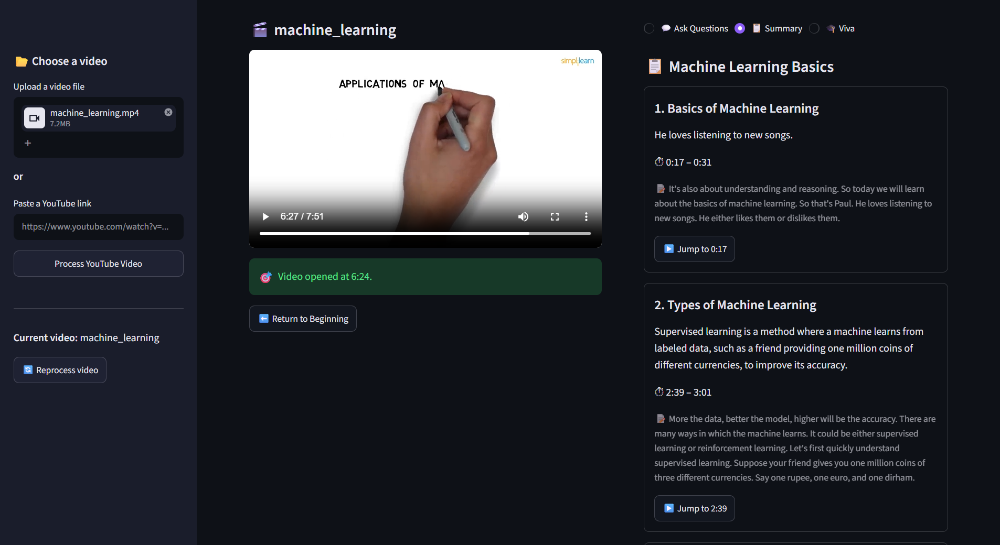
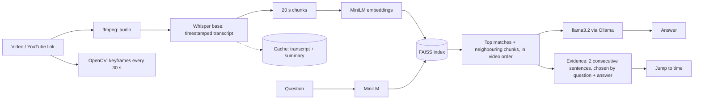

# 🎥 AI Video Assistant with RAG

Ask questions about a video and get answers **only from what the video says**, each with a
**Jump** button to the exact moment. Get a timestamped **summary**, and test yourself in a
**viva** whose answers are checked against the video.

Everything runs **locally**: Whisper, MiniLM + FAISS and llama3.2 (Ollama). No cloud API and
no API key are needed.


---

## Features

| | |
|---|---|
| **📂 Any video** | Upload an MP4/MOV/AVI/MKV, or paste a YouTube link. |
| **💬 Ask Questions** | Retrieval-augmented answers from the transcript. Each answer shows the evidence sentence, its time (e.g. `6:55 – 7:02`) and a **Jump** button. Questions the video does not answer get *"I don't have enough information in the video."* |
| **📋 Summary** | The main points of the video, each with its time, the words spoken there and a Jump button. Downloadable. |
| **🎓 Viva** | Questions generated from the summary, grounded in the transcript. Answers are graded **Correct / Partly correct / Incorrect** with feedback, the expected answer and a Jump button. Downloadable results. |
| **⚡ Cache** | A video that was processed before opens in seconds (transcript and summary are reused). |
| **⚙️ Settings** | Answers can use llama3.2 (fast) or llama3.1 8B (more complete, slower). |

| Summary | Viva |
|---|---|
|  |  |

---

## How it works



1. **Processing.** ffmpeg extracts the audio, and Whisper (base) produces a transcript with start
   and end times. The transcript is cut into ~20 s chunks, embedded with
   `all-MiniLM-L6-v2` and indexed with FAISS. Keyframes are extracted every 30 s and matched
   to the transcript.
2. **Question answering.** The question is embedded and the 6 most similar chunks are retrieved
   (threshold 0.25). The chunk **before and after** each match is added, because Whisper often
   cuts a sentence between two chunks. The passages go to llama3.2 **in video order with readable
   times**, with an instruction to answer completely and only from the transcript (temperature 0).
   If nothing matches, the model is not called at all.
3. **Evidence and Jump.** Every 2 consecutive transcript sentences form a candidate. The
   candidate most similar to the **question** and to the **best-matching answer sentence** is
   shown, and Jump seeks the player to its start.
4. **Summary and viva.** The summary points come from real transcript chunks. Viva questions are
   generated from them, and every question is checked: is it grounded in the transcript, is it not
   a yes/no question, does the expected answer really answer it (for example, a "difference",
   "why" or "what influences" question needs a contrast, reason or cause in the answer)?
   Otherwise it falls back to a fill-in-the-blank question on a real transcript sentence. Answers
   are graded with MiniLM similarity, key-word coverage, a relevance gate and a llama3.2
   examiner.
5. **Cache.** The transcript and the summary are saved under `data/cache/`, keyed by the video's
   MD5 hash, the model names and a pipeline version, and reused the next time.

---

## Setup (Windows)

**Requirements:** Python 3.11, [ffmpeg](https://ffmpeg.org/download.html) on the PATH and
[Ollama](https://ollama.com/download).

```
git clone https://github.com/yashkush2010-del/ai-video-assistant-rag.git
cd ai-video-assistant-rag

python -m venv .venv
.venv\Scripts\activate
pip install -r requirements.txt

ollama pull llama3.2
```

Optional, for the larger answer model: `ollama pull llama3.1` (about 4.7 GB).

## Run

```
streamlit run app.py
```

Open http://localhost:8501, choose a video in the sidebar and wait for **✅ Video ready**.
The first time a video is processed takes about 2 minutes for a 7–8 minute video on a laptop CPU.
After that, it opens in seconds.

---

## Results (measured on a laptop CPU, Intel Iris, 16 GB RAM)

Two test videos on different topics: a machine-learning explainer (7:51) and
["How the Internet Works in 5 Minutes"](https://www.youtube.com/watch?v=7_LPdttKXPc).
The test questions and expected key facts are in `scripts/qa_questions/` and are only used
for measuring; the app never sees them.

| Measurement | Before | After |
|---|---|---|
| Opening a processed video again | 124 s | a few seconds (cache) |
| Q&A score, machine learning video (12 questions) | 9.5 | **11** |
| Q&A score, Internet video (10 questions) | 8.5 | **9.5** |
| Questions the video cannot answer, correctly refused | 4 / 4 | **4 / 4** |
| Evidence / Jump at the right place (18 questions) | 13 | **15** |

Processing time before caching: Whisper 68 s (55 %), summary 38.5 s (31 %), everything else
about 18 s. Answers take about 8–9 s with llama3.2.

Reproduce:

```
python scripts\measure_processing.py
python scripts\check_qa_real_video.py --questions scripts\qa_questions\machine_learning.txt --label run
python scripts\check_qa_real_video.py --questions scripts\qa_questions\internet.txt --label run
python scripts\check_evidence.py
python scripts\check_viva_real_video.py
```

## Tests

```
python -m pytest -q
```

669 tests. They run without Whisper, MiniLM or Ollama (stand-ins), and include whole-app tests
with Streamlit's `AppTest` and regression tests built from real transcript sentences.

---

## Project structure

```
app.py                       Streamlit app (layout, sections, Jump)
.streamlit/config.toml       Theme
src/ingestion/               Video loading, YouTube download (yt-dlp), audio extraction
src/processing/              Transcription, chunking, embeddings, keyframes, cache
src/rag/vector_store.py      FAISS index, retrieval, neighbouring chunks, evidence
src/rag/answer_generator.py  Prompt and Ollama call for answers
src/rag/video_summary.py     Timestamped video summary
src/rag/viva.py              Viva questions and answer checking
src/rag/report_export.py     Downloadable summary and viva reports
scripts/                     Measurement and real-video checks
tests/                       Automated tests
```

## Known limitations

- **llama3.2 is a small (3B) model.** Answers are sometimes long or add related material from
  nearby passages. Viva grading can occasionally be too lenient. llama3.1 8B is available in
  Settings for answers.
- **Speed.** Whisper on a CPU takes about 9 s per minute of video, the first time only.
- **Spoken content only.** Text that is only shown on screen (slides, writing) is not in the
  transcript, so it cannot be asked about. Keyframes are shown, but not read.
- **English videos.** Other languages were not tested.
- **Evidence.** 3 of the 18 test jumps land a few seconds away from the best sentence.

## Author

Yashovardhan Kushwaha, M.Tech (AI)
