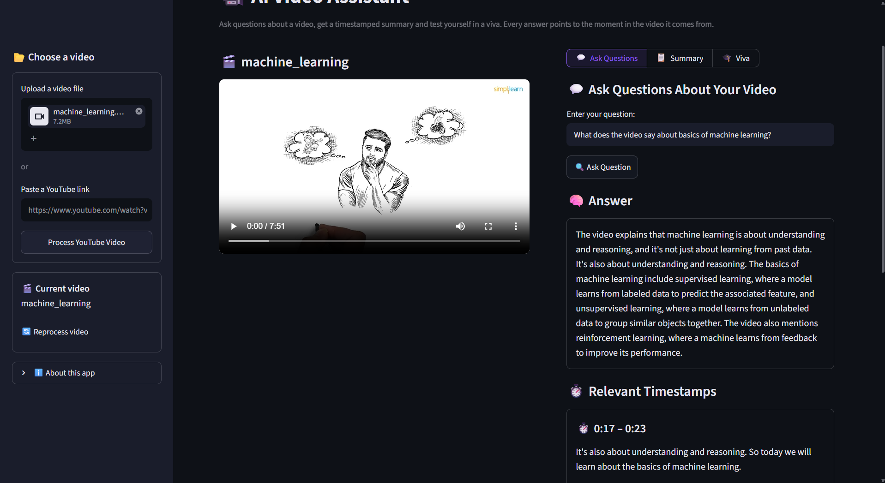
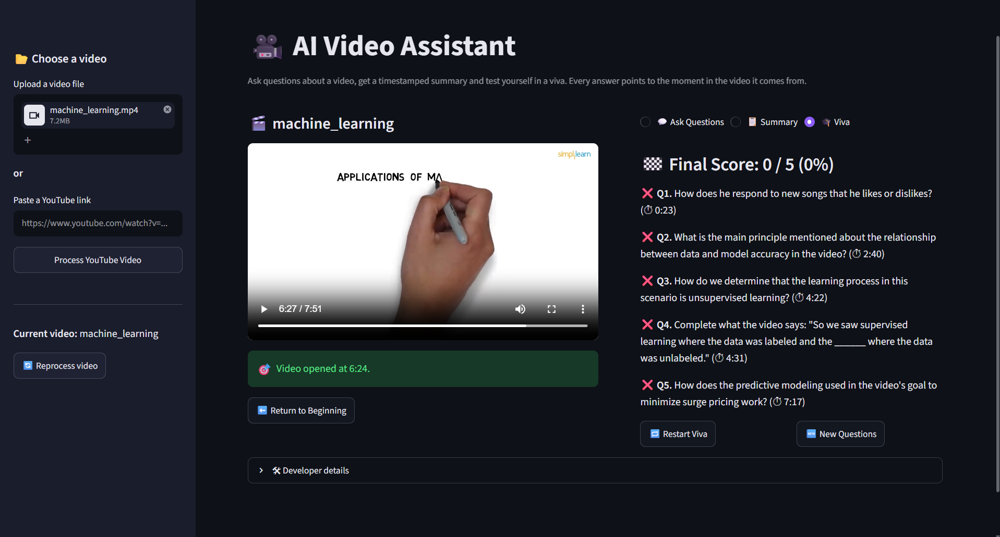
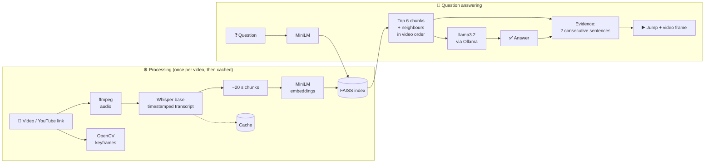

<div align="center">

# 🎥 AI Video Assistant with RAG

**Ask a video anything. Every answer comes only from what the video says, and jumps you to the moment it is said.**




</div>

---

## Contents

- [What it does](#what-it-does)
- [Features](#features)
- [How it works](#how-it-works)
- [Tech stack](#tech-stack)
- [Setup](#setup-windows)
- [Usage](#usage)
- [Results](#results)
- [Design decisions](#design-decisions)
- [Tests](#tests)
- [Project structure](#project-structure)
- [Troubleshooting](#troubleshooting)
- [Known limitations](#known-limitations)
- [Future work](#future-work)

---

## What it does

Lecture and tutorial videos are long, and finding *where* something was explained means
scrubbing through the timeline. This app turns a video into something you can **question,
skim and be tested on**:

1. **💬 Ask Questions.** Get an answer built only from the video's transcript (Retrieval-Augmented
   Generation), plus the exact sentence, its time, a frame from that moment and a **Jump** button.
2. **📋 Summary.** The main points of the video, each with its time and a Jump button.
3. **🎓 Viva.** Questions about the video; your answers are graded against what the video says.

If the video doesn't contain the answer, the app says so (*"I don't have enough information in
the video."*) instead of inventing one.

Everything runs **on your own computer**: no cloud API, no API key, no data leaves the machine.

---

## Features

| | Feature | Details |
|---|---|---|
| 📂 | **Any video** | Upload MP4 / MOV / AVI / MKV, or paste a YouTube link (downloaded with yt-dlp). |
| 💬 | **Grounded answers** | Retrieval with MiniLM + FAISS, and answers by llama3.2 from the retrieved transcript only. |
| 📍 | **Evidence and Jump** | Each answer shows the supporting sentence, its time range (e.g. `6:55 – 7:02`), **a video frame from that exact moment** and a Jump button that seeks the player. |
| 💡 | **Example questions** | One-click questions generated from the summary topics. |
| 📋 | **Timestamped summary** | Main points with time, the words spoken there and a Jump button. |
| 🎓 | **Viva mode** | 5 grounded questions per video. Answers are graded **Correct / Partly correct / Incorrect** with feedback, the expected answer and a Jump button. Includes a progress bar and a final score breakdown. |
| ⬇️ | **Downloads** | Summary and Viva results as a clean printable page (*Print → Save as PDF*). |
| ⚡ | **Cache** | A video that was processed before opens in **seconds** instead of about 2 minutes. |
| ⚙️ | **Model choice** | Answers by llama3.2 (fast) or llama3.1 8B (more complete, slower). |
| 🛡️ | **Robust** | Clear messages when Ollama is not running or a model is missing. A broken cache file never crashes the app. |

<table>
<tr>
<td width="50%"><b>📋 Summary</b><br></td>
<td width="50%"><b>🎓 Viva</b><br></td>
</tr>
</table>

---

## How it works



**Processing (once per video).**
1. ffmpeg extracts the audio.
2. Whisper (base) writes a transcript with a start and end time for every sentence.
3. The transcript is cut into ~20-second chunks, embedded with `all-MiniLM-L6-v2` and indexed in
   FAISS. Keyframes are extracted every 30 s.
4. The transcript and the summary are cached under `data/cache/`.

**Answering a question.**
1. The question is embedded, and the **6 most similar chunks** are retrieved (cosine similarity ≥ 0.25).
2. The chunk **before and after** each match is added (at most 9 chunks), because Whisper often
   cuts a sentence across two chunks.
3. The passages go to **llama3.2 in video order with readable times**, with an instruction to
   answer completely and only from the transcript (temperature 0, so the same question always
   gets the same answer). If nothing matched, the model isn't called at all, and the app says
   the video has no answer.
4. **Evidence:** every pair of consecutive transcript sentences is scored by its similarity to
   the *question* and to the *best-matching sentence of the answer*. The best pair is shown,
   with a frame read from the video at that moment, and Jump seeks the player there.

**Summary and Viva.**
- Summary points are built from real transcript chunks.
- Viva questions are generated from them, and each question is **validated**:
  - Is it grounded in the transcript?
  - Is it not a yes/no question?
  - Does the expected answer really answer it? For example, a "difference" question needs a
    contrast, a "why" question a reason and a "what influences" question a cause.
- A question that fails falls back to a fill-in-the-blank question on a real transcript sentence.
- Answers are graded with MiniLM similarity, key-word coverage, a relevance gate (unrelated
  answers are always incorrect) and a llama3.2 examiner.

---

## Tech stack

| Part | Technology |
|---|---|
| User interface | Streamlit (dark theme, sidebar, sections next to the video) |
| Speech-to-text | OpenAI Whisper `base` |
| Embeddings | Sentence-Transformers `all-MiniLM-L6-v2` |
| Vector search | FAISS (inner product on normalised vectors) |
| Language model | llama3.2 (3B), optional llama3.1 (8B), via Ollama |
| Video and audio | ffmpeg, OpenCV, yt-dlp |
| Testing | pytest, Streamlit `AppTest` |

---

## Setup (Windows)

**You need:** Python 3.11, [ffmpeg](https://ffmpeg.org/download.html) on the PATH and
[Ollama](https://ollama.com/download).

```
git clone https://github.com/yashkush2010-del/ai-video-assistant-rag.git
cd ai-video-assistant-rag

python -m venv .venv
.venv\Scripts\activate
pip install -r requirements.txt

ollama pull llama3.2
```

Optional, for the larger answer model (about 4.7 GB):

```
ollama pull llama3.1
```

---

## Usage

```
streamlit run app.py
```

1. Open **http://localhost:8501**.
2. In the sidebar, **upload a video** or **paste a YouTube link** and click *Process YouTube Video*.
3. Wait for **✅ Video ready**. The first time takes about 2 minutes for an 8-minute video on a
   laptop CPU; after that, the same video opens in seconds.
4. Use the three sections next to the video:
   - **💬 Ask Questions:** type a question and press Enter, or click an example. Click
     **Jump** to watch the moment.
   - **📋 Summary:** read the main points, jump to any of them, or download the summary.
   - **🎓 Viva:** generate questions, answer them and check each one. Download your results at
     the end.
5. **⚙️ Settings** in the sidebar lets you choose the model for answers. **🔄 Reprocess video**
   runs everything fresh.

---

## Results

Measured on a laptop CPU (Intel Iris graphics, 16 GB RAM) with two videos on different topics:
a machine-learning explainer (7:51) and
[How the Internet Works in 5 Minutes](https://www.youtube.com/watch?v=7_LPdttKXPc).

| Measurement | Before | After |
|---|---|---|
| Opening a processed video again | 124 s | **a few seconds** (cache) |
| Q&A score, machine-learning video (12 questions) | 9.5 | **11** |
| Q&A score, Internet video (10 questions) | 8.5 | **9.5** |
| Questions the video can't answer, correctly refused | 4 / 4 | **4 / 4** |
| Evidence / Jump at the right place (18 questions) | 13 | **15** |

Where the time goes on the first run (8-minute video):

| Step | Time |
|---|---|
| Whisper transcription | 68 s (55 %) |
| Summary with llama3.2 | 38.5 s (31 %) |
| Loading models, keyframes, embeddings, index | ~18 s |
| One answer with llama3.2 | ~8–9 s |

**How it was measured.**
- Each test question has a list of key facts a good answer must contain, plus the time window
  where the video says it (in `scripts/qa_questions/`).
- An answer is GOOD when it has all the key facts, PARTIAL when it has some (0.5 points), and
  BAD otherwise.
- A question the video can't answer must be refused.
- Two videos on different topics make sure the improvements are general and not tuned to one
  video. The app itself never sees these questions.

Reproduce:

```
python scripts\measure_processing.py
python scripts\check_qa_real_video.py --questions scripts\qa_questions\machine_learning.txt --label run
python scripts\check_qa_real_video.py --questions scripts\qa_questions\internet.txt --label run
python scripts\check_evidence.py
python scripts\check_viva_real_video.py
```

---

## Design decisions

| Decision | Why |
|---|---|
| **Everything local** (Whisper, MiniLM, Ollama) | No API costs or keys, and the video never leaves the computer. It works offline once the models are downloaded. |
| **~20 s chunks + neighbouring chunks** | Small chunks keep retrieval precise. Adding the chunk before and after each match repairs sentences that Whisper cut between two chunks (this raised the Q&A scores in the table above). |
| **Passages in video order with readable times** | A small model connects facts far better when it reads the transcript as it was spoken than when it reads it in score order. |
| **Temperature 0** | The same question about the same video always gets the same answer, which makes the app testable and predictable. |
| **No model call when nothing matches** | With an empty context, llama3.2 replied "Go ahead and ask your question" instead of admitting the video has no answer. |
| **Evidence from 2 consecutive sentences, scored by question + answer** | Whisper's pieces are often half sentences, and a long answer mentions side topics. Six methods were compared; this one was best (15/18 vs 13/18). |
| **Frame from the exact evidence moment** | Stored keyframes are 30 s apart, so the nearest one could show a different scene. |
| **Cache keyed by video hash + models + pipeline version** | A video is never processed twice, and a result made with other settings or older code is never reused by mistake. |
| **Viva questions validated, fill-in-the-blank fallback** | A small model sometimes writes questions that sound right but that its own passage doesn't answer. Rule checks reject those, and the fallback always uses a real transcript sentence. |
| **A stricter "max 4 sentences" prompt was tried and reverted** | It made llama3.2 drop facts it had been given (Internet score 10 → 8.5). Every change was measured before it was kept. |

---

## Tests

```
python -m pytest -q
```

**678 tests**, running in about 45 seconds. They need no Whisper, MiniLM or Ollama (stand-ins
are used):
- unit tests for every module;
- whole-app tests with Streamlit's `AppTest` (upload, YouTube, Q&A, Jump, Summary, Viva, cache,
  layout);
- regression tests built from real transcript sentences of the test videos.

---

## Project structure

```
app.py                           Streamlit app: layout, sections, Jump, downloads
.streamlit/config.toml           Theme
src/
  ingestion/
    video_loader.py              Uploaded videos
    youtube_loader.py            YouTube download (yt-dlp)
    audio_extractor.py           Audio with ffmpeg
  processing/
    chunker.py                   ~20 s transcript chunks
    keyframe_extractor.py        Keyframes every 30 s, matched to the transcript
    evidence_frame.py            One frame from the exact evidence moment
    processing_cache.py          Saved transcript and summary per video
  rag/
    vector_store.py              FAISS index, retrieval, neighbouring chunks, evidence
    answer_generator.py          Prompt and Ollama call for answers
    video_summary.py             Timestamped summary
    viva.py                      Viva questions and answer grading
    report_export.py             Downloadable summary and viva reports
scripts/                         Measurements and real-video checks
  qa_questions/                  Test questions (answer keys) for two videos
tests/                           Automated tests
docs/screenshots/                Screenshots used in this README
```

---

## Troubleshooting

| Problem | Fix |
|---|---|
| *"Ollama is not running"* | Open the Ollama app, or run `ollama serve` in a terminal. |
| *"The language model … is not installed"* | Run the `ollama pull …` command shown in the message. |
| Audio extraction fails | Install ffmpeg and check that `ffmpeg -version` works in a new terminal. |
| A YouTube video fails | Check the link, and update yt-dlp with `pip install -U yt-dlp`. |
| A video downloaded from a browser has no sound | Browser downloads from YouTube are often picture-only. Use the YouTube link option instead. |
| Old results after changing code | Click **🔄 Reprocess video** in the sidebar. |

---

## Known limitations

- **Small model.** llama3.2 has 3B parameters. Answers are sometimes long or bring in related
  material from nearby passages, and Viva grading can occasionally be too lenient. llama3.1 8B
  (Settings) gives more complete answers, but more slowly.
- **CPU speed.** The first processing of a video takes about 9 s per minute of video. After
  that it's cached.
- **Spoken content only.** Text that only appears on screen (slides, writing) isn't in the
  transcript, so the app can't answer questions about it. Frames are shown, but not read.
- **English.** Other languages weren't tested.
- **Evidence.** 3 of the 18 test jumps land a few seconds away from the best sentence.

## Future work

- On-screen text with OCR, so slides and writing can be searched too.
- A chat-style history of questions and answers.
- Multi-language transcription and answers.
- A re-ranking model to choose the best passages before answering.
- Processing on a GPU when one is available.

---

<div align="center">

**Yashovardhan Kushwaha** · M.Tech (Artificial Intelligence)

[GitHub: yashkush2010-del](https://github.com/yashkush2010-del)

</div>
